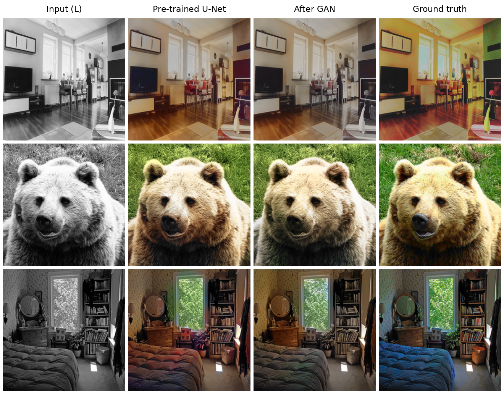
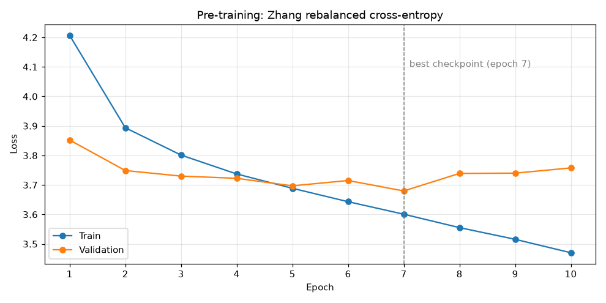

# Autocolorizer

> Automatic colorization of black-and-white photos with a U-Net (EfficientNet-B4 encoder) that classifies every pixel into one of 313 Zhang color bins.

**Authors:** Malwina Belczewska & Oliwier Mróz



*COCO val2017 images. Columns: grayscale input · pre-trained U-Net (final model) · after GAN training · ground truth (quantized to the 313 bins).*

The **final model is the pre-trained U-Net**. We also tried adversarial (PatchGAN) training on top of it, but it did not improve the results (see [Results](#results)).

------------------------------------------------------------------------

## Quick start

[](https://colab.research.google.com/github/omroz14/NN-Autocolorizer/blob/main/Autocolorizer_EN.ipynb)

Everything (data loading, training, evaluation, plots) lives in one notebook, [`Autocolorizer_EN.ipynb`](Autocolorizer_EN.ipynb).

1. Install the dependencies (developed on Python 3.11):

   ``` bash
   pip install torch torchvision segmentation-models-pytorch scikit-image Pillow tqdm matplotlib numpy
   ```

2. Download [COCO 2017](https://cocodataset.org/#download) (`train2017` and `val2017`) and set `TRAIN_DIR` / `VAL_DIR` in the dataset cell to the matching folders.

3. Run the notebook. The Zhang quantization files (`pts_in_hull.npy`, `prior_probs.npy`) are downloaded automatically on first run.

### Pretrained weights

The checkpoints (~80–270 MB each) are not in the repository because of their size. They are in this **[Google Drive folder](https://drive.google.com/drive/folders/1Y0CaliVxfVj_rxoWWUAJ-ZFTegNpwm8D?usp=sharing)**, along with other project assets.

------------------------------------------------------------------------

## How it works

Treating colorization as regression (predicting exact color values) makes the network average uncertain colors, which gives desaturated, brownish images. Following [Zhang et al. (2016)](https://arxiv.org/abs/1603.08511), we treat it as **classification** instead:

1. Convert the image to CIELab. The lightness channel **L** is the input.
2. Quantize the color channels **ab** into **313 bins**. Each pixel's target is the index of its nearest bin.
3. The network predicts a probability distribution over the 313 bins for every pixel.
4. Turn that distribution back into a color with the **annealed mean** (softmax at temperature `T = 0.38`). This is sharper than a plain average and smoother than argmax.

A **rebalanced cross-entropy** loss weights rare, saturated colors more heavily so the model doesn't settle for safe sepia tones.

### Generator: U-Net + EfficientNet-B4

| Component   | Details                                                         |
|-------------|-----------------------------------------------------------------|
| **Encoder** | EfficientNet-B4, pretrained on ImageNet                         |
| **Decoder** | U-Net with skip connections (`segmentation_models_pytorch.Unet`) |
| **Input**   | L channel repeated ×3 → `256 × 256 × 3`, so ImageNet weights load unchanged |
| **Output**  | 313 logits per pixel                                            |

Skip connections preserve fine detail and keep colors from bleeding across edges.

### Discriminator: PatchGAN (GAN phases only)

A PatchGAN judges local `70×70` patches instead of the whole image and outputs a `30×30` realism map. It uses spectral normalization, InstanceNorm and LeakyReLU(0.2), takes the concatenation of `L` and `ab` as input, and is trained as an LSGAN (MSE instead of BCE).

### Generator loss

```
L_total = λ_zhang · L_zhang + λ_l1 · L_l1 + λ_adv · L_adv
```

| Term | What it does | Used in |
|------|--------------|---------|
| `L_zhang` | Rebalanced cross-entropy over the 313 bins | all phases |
| `L_l1` | L1 between the annealed-mean `ab` and ground truth | GAN phases |
| `L_adv` | LSGAN signal from the PatchGAN | GAN phases, after warmup |

------------------------------------------------------------------------

## Training

<details>
<summary>Training setup, phases and hyperparameters</summary>

### Data

- **Train:** the first 30 000 images of COCO `train2017` (in directory-listing order, not a random sample).
- **Validation:** the first 1 000 images of COCO `val2017`.
- Images are resized to `256 × 256`. Near-grayscale images (`std(ab) < 0.5`) are skipped.
- Augmentation (train only): horizontal flip, `RandomResizedCrop(scale 0.8–1.0)`, lightness scaling by a factor in `[0.85, 1.15]`.
- Batch size 8, seed 42.

### Hardware

A single NVIDIA RTX 3060 (12 GB). One epoch over 30 000 images takes about 1 hour; all three phases together took about 35 hours.

### Phase 1: U-Net pre-training (10 epochs)

The generator alone, trained with `L_zhang` only. Adam (`lr = 3e-4`), gradient accumulation over 4 steps, mixed precision (AMP), gradient clipping at 1.0, `ReduceLROnPlateau` (×0.5 after 3 epochs without improvement) and early stopping (patience 7).

### Phase 2: GAN training (15 epochs, 5 warmup)

Starts from the best pre-trained checkpoint. For the first 5 epochs only the generator trains, so it can adapt to the new loss before the discriminator starts. After that, D and G update alternately every iteration.

### Phase 3: fine-tuning (10 epochs, no warmup)

Resumes from the best Phase 2 checkpoint with a weaker L1 term, a stronger adversarial term and a lower generator learning rate, so the discriminator has more influence.

| Parameter               | Phase 1 | Phase 2 | Phase 3 |
|-------------------------|---------|---------|---------|
| Max epochs              | 10      | 15      | 10      |
| Epochs actually run     | 10      | 10 (early stop) | 8 (early stop) |
| Warmup epochs           | –       | 5       | 0       |
| `lambda_zhang`          | 1.0     | 1.0     | 1.0     |
| `lambda_l1`             | –       | 10.0    | 2.0     |
| `lambda_adv`            | –       | 0.1     | 0.2     |
| `lr_G`                  | 3e-4    | 2e-4    | 1e-4    |
| `lr_D`                  | –       | 5e-5    | 5e-5    |
| Gradient accumulation   | 4       | 2       | 2       |
| Early stopping patience | 7       | 7       | 7       |

</details>

------------------------------------------------------------------------

## Results

**The pre-trained U-Net is the best model.** It gives plausible colors for most scenes: grass, foliage, wood, fur and skin come out right. It tends to under-saturate objects whose color is ambiguous from lightness alone (in the example above, the blue duvet comes out brown).



Pre-training reached its best validation loss at epoch 7 (3.680) and started to overfit after that.

**GAN training did not help.** In both GAN runs, validation loss was lowest within the first few epochs and then rose until early stopping:

| Run | Validation loss measured as | Best val | Best epoch |
|-----|------------------------------|----------|------------|
| Phase 1: pre-training | `L_zhang` | 3.680 | 7 / 10 |
| Phase 2: GAN | `L_zhang + 10 · L_l1` | 4.475 | 3 / 10 (still in warmup) |
| Phase 3: fine-tuning | `L_zhang + 2 · L_l1` | 3.952 | 1 / 8 |

> The validation numbers are **not comparable across rows**, because each run's validation loss includes a different L1 weight. They only show the trend within a run.

In Phase 2, the best checkpoint came from the warmup, before the discriminator was switched on. Once it started (epoch 6), validation loss rose steadily (4.52 → 4.56 → 4.66). Our reading is that the strong L1 term (`λ_l1 = 10`) drowned out the adversarial signal. Phase 3 lowered it (`λ_l1 = 2`, `λ_adv = 0.2`), but validation loss still went up from the first epoch. Visually, the GAN output is slightly more muted than the pre-trained U-Net.

Balancing the L1 and adversarial terms remains the main open problem, and it is a known difficulty in conditional image generation. Likely next steps: longer GAN training, more data, a more global encoder (e.g. a Swin Transformer), and image-quality metrics (PSNR, SSIM, LPIPS or colorfulness) instead of the training loss alone.

------------------------------------------------------------------------

## References

- Zhang, R., Isola, P., & Efros, A. A. (2016). **Colorful Image Colorization**. *ECCV 2016*. [[paper]](https://arxiv.org/abs/1603.08511) [[code]](https://github.com/richzhang/colorization)
- Isola, P., Zhu, J. Y., Zhou, T., & Efros, A. A. (2017). **Image-to-Image Translation with Conditional Adversarial Networks**. *CVPR 2017*. [[paper]](https://arxiv.org/abs/1611.07004)

The color quantization data (`pts_in_hull.npy`, `prior_probs.npy`) comes from [richzhang/colorization](https://github.com/richzhang/colorization) under the BSD-2-Clause license.

## License

MIT. See [LICENSE](LICENSE).

---

<sub>The notebook was originally written in Polish and translated to English, so some console output and plot labels are still in Polish.</sub>
